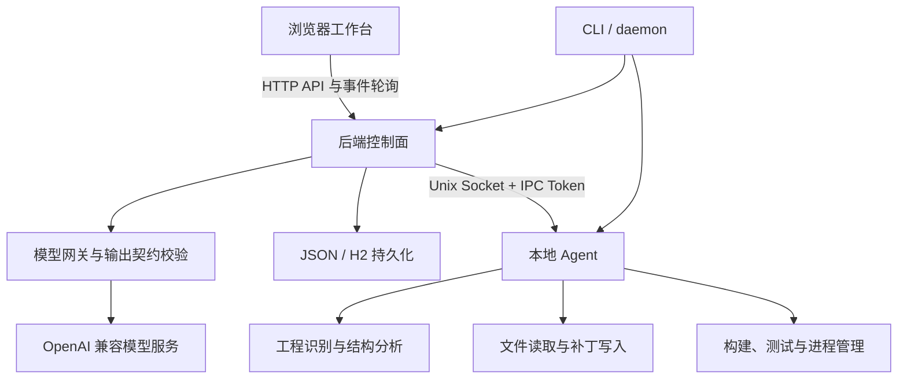

# CodeSpider 项目实现说明

> 编写日期：2026-10-13。基准版本：`0865fda`，项目版本：`0.1.0`。本文依据源码、Git 记录和仓库内实测报告编写；检查时工作区已有未提交改动，相关能力单独标记。测试数字引用历史报告，本次文档整理未重新执行测试或调用付费模型。

## 1. 项目介绍

CodeSpider 是一个面向代码工程的 AI Agent 工作台。用户通过浏览器选择本地工程、提出开发需求，系统读取受控范围内的代码，调用大模型生成修改方案和补丁，经用户批准后写入文件、执行构建或测试，并展示结果。

项目希望解决的是从“模型给出一段代码”到“代码真正进入工程并得到验证”之间的落地问题。当前重点覆盖 Python、Java Spring Boot 和 Vue 小型工程，适合个人开发、受控环境中的原型验证，以及代码生成流程的实验。

当前已形成可运行的 MVP，具备真实模型接入和工程生成验收证据；复杂仓库理解、长期自主执行、故障恢复和多人隔离仍有明显扩展空间。

## 2. 功能介绍

| 功能 | 当前实现 |
| --- | --- |
| 工程管理 | 创建工程或打开已有目录；按项目名默认创建到 `~/.codespider/project/`；支持工程说明、启动命令及执行策略配置。 |
| 浏览器工作台 | 首页、工程对话、文件目录树、文件内容预览、结构审查、产物、命令输出和设置视图；支持侧栏折叠、文件区宽度调整。 |
| 代码理解 | 识别 Python、Java、Vue 工程；提取符号和部分依赖关系；向模型提供有预算的源码、文件哈希与结构摘要。 |
| AI 代码生成 | 接入 OpenAI 兼容的 Chat Completions 服务；生成结构化回复、计划、设计说明与文件补丁；已有报告使用 `qwen3.8-max`。 |
| 审批与执行 | 安全模式下读取源码并发送给模型需要确认；修改方案经过审批后执行；展示文件变更、命令、退出码及任务结果。 |
| 代码验证 | Python 语法检查及已发现的 unittest；Java Maven 测试；Vue 依赖安装、构建和已配置的测试脚本。 |
| 设计约束 | 可用 `design-contract.json` 定义模块分层、允许依赖与禁止导入；支持建议模式和强制模式。 |
| 会话与任务记录 | 保存工程对话、自由对话和关联任务；刷新后恢复历史、待审批入口及运行中任务的事件查询；已完成任务详情自动折叠。 |
| 账户与模型管理 | 注册、登录、管理员/普通用户角色、模型配置与分配、模型选择、积分充值及用量记录。 |
| 记忆与文档 | 保存任务摘要、项目记忆、偏好和 Skill；提供关键词检索；生成包含工程信息及符号索引的 Markdown 文档。 |
| 服务管理 | CLI 启停、状态与日志查询；daemon 管理 Web 与 Agent 进程；提供 systemd 部署配置。 |

本地演示模型可以帮助验证工程分析和执行流程，但不会自动生成代码。真实生成需要配置可用的模型服务。

## 3. 实现思路与关键取舍

### 3.1 控制面与执行面分离

系统分为浏览器工作台、后端控制面和本地 Agent 执行面。控制面管理账户、模型调用、任务和状态；执行面负责工程文件操作、命令及进程管理。



daemon 模式下 Web 与 Agent 分进程运行；前台开发模式可以使用嵌入式 Agent。这里的进程分离便于管理生命周期和替换执行方式，但两个进程仍使用主机权限，不能视为容器或操作系统沙箱。

| 目录 | 主要职责 |
| --- | --- |
| `frontend/` | 页面、工程切换、聊天、审批、事件同步与管理设置。 |
| `backend/` | HTTP API、任务编排、模型网关、账户、存储、工具协议及策略。 |
| `agent_client/` | 文件工具、命令执行、进程管理及 IPC 服务。 |
| `code_intelligence/` | 工程类型识别、符号索引、设计契约与依赖检查。 |
| `memory/` | 记忆、偏好和 Skill 的保存及检索。 |
| `codespider/` | 命令行入口、daemon 与本机通信。 |
| `tests/`、`benchmarks/`、`examples/` | 系统回归、生成评测、独立验收与可运行案例。 |

### 3.2 将模型输出变成可检查的工程变更

一次远程生成任务的主要流程是：

1. 选择工程和模型，确认允许读取并发送源码。
2. 收集工程类型、选中文件、符号、文件哈希和设计契约。
3. 模型输出结构化内容，网关完成 JSON 解析、字段归一化和补丁校验；遇到部分网络或契约错误时有限重试。
4. 对拟修改后的源码做结构预检，展示回复、方案和文件变更，等待用户审批。
5. 审批后重新检查规则及源码，按顺序写入补丁。
6. 重新识别工程类型，安装必要依赖、执行构建或测试，再做结构检查。
7. 保存结果与事件；失败时保留错误和已发生的变更，供用户决定下一步。

已有文件修改使用完整旧内容 `expected` 校验，也支持由 `base_sha256` 校验后补全旧内容；文件在生成后被改动时拒绝覆盖。新文件使用独占创建，避免覆盖同名文件。文件锁可以协调 CodeSpider 自身的写操作，但不能约束外部编辑器和任意用户命令。

模型回复中的步骤和工具声明用于表达方案，当前执行器主要按“补丁 → 固定工程验证”流程执行。尚未实现根据每次工具结果持续自主规划、自动修复直至完成的通用 Agent 循环。

### 3.3 优先降低启动和迭代成本

后端使用 Python 标准库 HTTP 服务，前端使用原生 HTML、CSS 和 JavaScript，无需单独构建前端。任务并发采用线程池，事件通过带游标的 HTTP 轮询获取，客户端负责去重和失败退避。

这一方案让 MVP 的安装、调试和故障定位比较直接。代价是前端状态管理逐渐集中、后端路由与业务耦合增加，轮询也有额外请求开销。用户规模和交互复杂度增加后，再逐步引入组件化、流式传输和更明确的服务边界更合适。

“无前端构建依赖”不等于整套系统没有环境依赖：Python 要求 3.9+；默认 daemon 账户模式还需要 Java/Javac 和 H2 JDBC jar；运行生成的 Java/Vue 工程分别需要 Maven/JDK、Node/npm。当前依赖 Unix Socket、文件锁和进程组机制，主要支持 macOS/Linux。

### 3.4 持久化先满足单机使用

工程、任务、事件和部分配置使用 JSON 文件保存；认证模式下，账户、模型、积分和会话等使用 H2，通过 Java JDBC bridge 访问。H2 中主要以 JSON 集合形式存储数据，保留了与开发用 JSON store 接近的接口。

这样减少了早期数据模型和部署成本，但集合级读改写不适合大量历史事件或高并发请求。锁能协调访问，也不能直接替代跨集合事务。后续需要围绕分页、索引、数据迁移和计费一致性演进。

### 3.5 先提供可解释的代码检查

Python 使用标准库 AST；Java、JavaScript、Vue 使用轻量词法/正则提取。结构审查检查识别到的本地导入、循环和分层依赖，默认 `advisory` 模式给建议，`enforce` 模式阻止违规变更。

这一选择能较快覆盖主要案例，并且让检查结果可追溯到源码。它尚不具备完整类型解析、动态调用分析或大仓库语义理解能力；“没有发现越层依赖”也不能证明业务设计一定合理。

生成上下文默认最多 24 个文件、约 96 KB，单文件约 64 KB；独立结构审查最多 120 个文件、约 512 KB，目录枚举上限 1000 项。超出范围会标记不完整，强制模式不能把不完整分析当作通过。

### 3.6 用实际执行和独立验收判断质量

生成结果需要通过构建/测试，评测案例还使用未提供给模型的独立验收代码。保存模型补丁后可以重新执行同一份输出，区分模型错误、验证器误报和依赖环境故障，也减少重复调用模型的成本。

例如，基础生成评测中的 Java/Vue 首轮失败来自依赖下载超时，调整环境后原补丁重放通过；工程化评测则实际发现了 Spring 测试注解包名错误及 Vue 错误状态、选择器不符合约定，需要模型修复。两类情况在报告中分别记录。

## 4. 当前完成程度

### 4.1 已完成并有实现依据

工程创建与浏览、真实模型生成、补丁审批与执行、构建/测试反馈、账户与模型分配、任务/会话持久化、基础结构检查、CLI 服务管理均已实现。核心“需求 → 变更 → 验证 → 反馈”流程已经跑通。

已保存的验证记录如下：

| 验证项 | 仓库记录的结果 | 说明 |
| --- | --- | --- |
| 基础生成 4 例 | 首轮 2/4；环境调整后相同补丁重放 4/4 | Python 购物车、已有代码精度修复、Spring 接口、Vue 计数器。 |
| 工程化生成首批 4 例 | 检查器校准及必要修复后最终 4/4 | 多模块 Python、既有工程策略扩展、Spring MVC 分层、Vue 状态与 API 分离；不能表述为一次生成全通过。 |
| 工程化生成第二轮 4 例 | 首轮 2/4；反馈修复后 4/4 | Spring 和 Vue 存在实际实现/测试契约问题。 |
| 反向结构验收 | 3 例违规均被强制规则拦截 | 人为引入 Python 循环依赖、Spring/Vue 越层依赖。 |
| 会话保存阶段系统回归 | 103 项 Python 回归及 4 组前端脚本通过 | 来源为会话功能报告，不代表检查时所有未提交改动已重新通过。 |

这些结果说明限定需求下的流程可执行、问题可发现和修复。样本量有限，不能据此推导复杂工程的普遍成功率或给整个产品一个精确“完成百分比”。

### 4.2 已有基础，但尚不完整

| 能力 | 当前边界 |
| --- | --- |
| 代码索引 | 主要采用全量扫描；Java/Vue 无完整 AST 和类型推导；没有成熟的增量索引与跨文件语义检索。 |
| 任务恢复 | 浏览器刷新可恢复记录和继续查询；服务重启后的任务不会自动续跑。 |
| 执行安全 | 有路径校验、符号链接防护、审批、命令分级、超时和环境变量筛选；无容器隔离、网络隔离及完整资源配额。 |
| 账户隔离 | 对话和任务接口有归属检查；工作区、通用工具和文件访问尚不能等同于完整多租户资源隔离。 |
| 记忆与 Skill | 有存取和关键词检索；尚无完整的检索注入、记忆失效处理、自动总结和 Skill 调用编排。 |
| 工程文档 | 能生成工程信息与符号清单；尚非完整的业务语义、架构和 API 文档生成系统。 |
| 自动测试 | Python 默认适配 unittest；Java 验证以 Maven 为主；识别出 Gradle 文件不代表已适配 Gradle 执行。Vue 无测试脚本时主要验证构建。 |
| 计费 | 有内部积分和调用记录；未形成按 token、供应商价格、失败重试及账单对账的美元成本统计。 |

### 4.3 尚未完成

- 任务级文件快照、一键回滚及多文件修改的事务式恢复；取消或验证失败不会撤销已完成写入。
- 持久化任务队列、暂停/续跑、Agent 断线重连后的执行恢复。
- 有预算上限的自主修复循环，以及更完整的工程对话上下文利用。
- 完整 IDE 编辑体验、成熟 Diff 编辑器、交互式终端和模型回复实时流式显示。
- 完整的源码内敏感信息扫描、集中审计与执行沙箱。
- 大规模多人协作、分布式执行节点和原生 Windows 支持。

### 4.4 工作区正在推进的新增项

检查时已有未提交代码涉及自由对话真实模型接入、工程 ZIP 下载、每日签到积分。自由对话的已提交版本使用固定回复，新版增加模型请求；下载已有后端入口和页面入口；签到已有服务逻辑及前端改动。

这些内容仍在工作区演进中，本文不将其计入已验收交付范围，也不把已有历史测试报告作为这些改动的验收证据。

## 5. 如果继续投入，如何扩展

优先级按“是否影响已有代码与数据、是否提高真实任务成功率、是否有实际规模需求”判断。

| 优先级 | 扩展方向 | 优先原因与完成标准 |
| --- | --- | --- |
| P0 | 变更快照、失败恢复与取消语义 | 系统已经会修改真实工程，应优先降低失败成本。每个任务能查看前后差异；中途失败后可选择性恢复，并拒绝覆盖用户后续修改。 |
| P0 | 工作区授权与执行隔离 | 在开放多人或不可信代码使用前，统一工作区、工具、文件和进程的授权检查；采用隔离执行目录/容器，配置网络及资源限制。单人本地使用可先收紧可访问目录。 |
| P0 | 实际费用与计费一致性 | 记录每次供应商请求、token、失败、重试、价格版本和金额；统一积分与任务生命周期的关系，加入预算上限、事务和幂等保护。 |
| P1 | 可靠任务队列与有限自动修复 | 保存执行检查点；重启后明确可恢复状态；允许基于失败日志修复，但限制轮数、时间、费用和修改范围，保留用户审批。 |
| P1 | 更准确的工程上下文 | 引入增量索引、依赖驱动的文件选择；逐步接入 Tree-sitter 或语言服务器；提高大工程相关文件召回率，明确未覆盖范围。 |
| P1 | 扩大独立评测与框架适配 | 增加真实缺陷修复、跨文件重构、pytest/Gradle、框架版本兼容案例；分别统计首轮成功率、修复成功率、耗时、费用和无关修改。 |
| P2 | 编辑器与流式交互 | 引入更清晰的 Diff、代码跳转、流式回复及命令输出；同时拆分前端状态管理，降低交互回归成本。 |
| P2 | 可管理的记忆与 Skill | 增加来源、适用条件、版本、失效机制和用户确认，再把检索结果接入生成上下文，验证是否确实减少重复错误。 |
| P3 | 团队协作与规模化 | 有明确使用量后，再做集中数据库、远程执行节点、组织权限和共享模板，避免过早增加部署及运维成本。 |

如果只再投入一个短迭代，优先完成变更可恢复、权限边界和费用可见，并将现有典型案例纳入持续回归。这几项直接改善每一次真实使用的可控性。

## 6. AI coding 的使用情况与费用

### 6.1 区分开发项目与项目调用 AI

本项目的 AI 使用需要分两个口径描述：

- **开发 CodeSpider 本身**：AI coding 用于辅助项目实现与迭代。当前仓库记录了功能开发、问题修复和验证的演进，但未保存完整的开发工具账单、逐轮提示或人工/AI 代码归属，因此无法核实各工具占比，也不能声称“全部代码由 AI 生成”。
- **CodeSpider 运行时使用模型**：通过兼容接口调用模型生成工程和修复代码。仓库明确记录了 `qwen3.8-max` 的实测、模型补丁和后续反馈修复，证据相对完整。

从 Git 记录可核实，首个提交时间为 2026-10-12 21:39，基准提交时间为 2026-10-13 23:33，期间有 16 次提交。这反映了约 26 小时的提交时间跨度，不能当作实际开发工时或模型使用时长。

### 6.2 AI 带来的价值及人工把关点

可核实的运行案例显示，AI 能较快生成跨语言工程、实现测试并根据失败反馈修改代码；在既有 Python 工程扩展策略的案例中，模型只修改算法模块并新增测试，保留了受保护的服务、接口等文件。

同时，实测出现过不存在的框架 import、测试 Bean 装配冲突、错误状态和界面选择器遗漏，以及旧文件回显少一个末尾换行等问题。这说明 AI coding 的有效流程需要包括：明确需求与边界、审查变更、真实执行测试、独立验收、归因失败，再进行修复。

人工判断尤其重要的部分是验收标准本身。仓库报告也记录了验收器对异常类型、按钮显示时机的误判，以及结构检查器误判空包文件等问题；不能为了获得通过结果，直接让模型修改测试或放宽规则。

### 6.3 花费约多少美元

**截至本文编写，缺少开发工具用量/订阅分摊信息及模型供应商账单，无法给出可信的实际美元金额；金额待项目负责人补充。这里的“待核实”不表示费用为 0 美元。**

| 费用口径 | 已知信息 | 能否得到实际美元金额 |
| --- | --- | --- |
| AI coding 开发费用 | 未记录工具订阅、API 用量及本项目分摊比例 | 暂不能。订阅制需区分总订阅费和本项目分摊，不宜全部计入项目。 |
| 项目运行/评测模型费用 | 有部分调用及修复记录，没有完整 token 与价格记录 | 暂不能。还需计入上游失败或契约重试可能发生的收费。 |
| 内部积分 | 用量记录中 `cost=1`，代表一次内部记账扣 1 积分 | 不能换算。积分未定义固定美元兑换关系。 |
| 服务器和运行环境 | 有部署配置，缺少资源账单 | 如统计项目总成本，需单列；不混入 AI coding 费用。 |

补齐数据后可按以下口径估算：

```text
本项目 AI 总费用（美元）
  = AI coding 工具的项目分摊费用
  + 开发阶段另行付费的模型 API 费用
  + CodeSpider 运行与评测的模型 API 费用

按 token 计价的 API 费用
  = Σ（未缓存输入 token × 输入单价
       + 缓存输入 token × 缓存单价
       + 输出 token × 输出单价）/ 1,000,000
```

单价按供应商实际账期及模型版本填写；没有缓存优惠的服务按其实际计价处理，其他收费项目、赠送额度和折扣以账单为准。同一笔调用若已包含在订阅中，不再重复计入 API 费用。人民币账单需注明折算美元所用的汇率和日期。

目前可直接对外使用的费用表述为：“本项目采用 AI 辅助开发，并通过真实模型调用验证代码生成能力；AI 费用尚未单独归集，待开发工具用量和模型账单核算后补充，系统内积分不代表美元支出。”

## 7. 依据与进一步阅读

- [README：启动与使用](../README.md)
- [需求说明](requirements.md)、[技术设计](technical-design.md)：包含目标架构和规划；当前完成情况以源码及本文边界说明为准。
- [设计契约与结构验收](design-contracts.md)
- [基础工程生成实测](generation-validation.md)
- [工程化生成首批验收](engineering-validation.md)
- [工程化生成第二轮案例](generation-cases-2026-10-13.md)
- [会话持久化与回归记录](conversation-history.md)
- [项目聊天恢复与真实模型验证](project-chat-recovery.md)
- [机器可读评测报告](../benchmarks/reports/)
