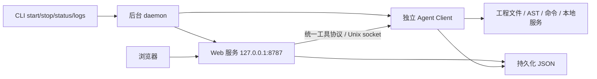
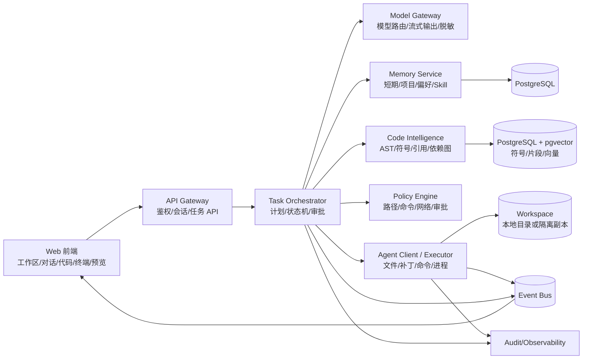
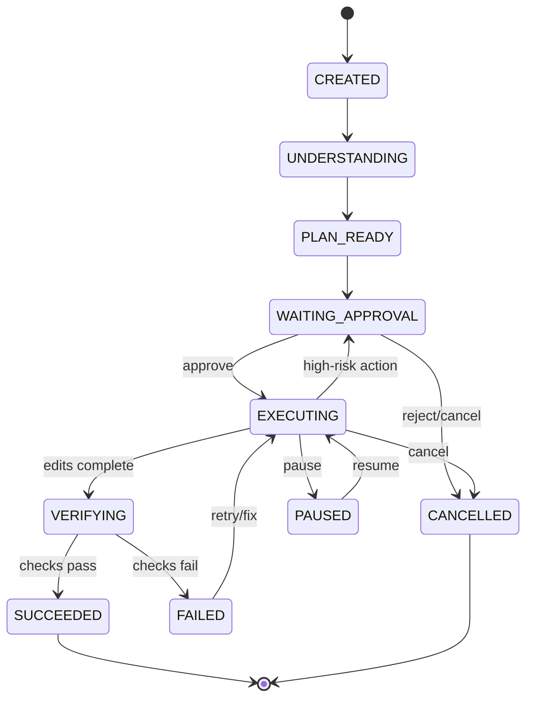

# 代码工程 Agent 系统技术设计文档

**版本**：v0.1  
**状态**：技术基线  
**关联需求**：[requirements.md](./requirements.md)

## 当前实现：本机安装与进程模型

本节描述已实现的 MVP。后续章节中的 Vue/FastAPI/PostgreSQL、容器沙箱等为演进设计，并非当前安装依赖。



- CLI 入口为 `codespider` 或 `python3 -m codespider`。daemon 脱离启动终端，使用独立进程管理 Web 与 Agent，不依赖 Node。
- Web 提供随 Python wheel 分发的静态前端、项目管理、任务编排和 HTTP API。Agent 负责文件、索引、文档和命令工具；原兼容工具路由也转发到相同的 Agent。项目创建时的初始识别/索引仍由工作区管理器完成。
- Web 到 Agent 使用 API v1.0 的 ToolRequest/ToolResponse；浏览器入口仍为 `/api/tools/call`。Agent 不额外暴露 TCP 端口。
- 控制 socket 与 Agent socket 位于系统临时目录中按数据目录哈希确定的私有目录；目录权限 0700、socket 0600，并使用每次启动随机生成的 Bearer token 验证。token 不通过 status 或 health 返回。
- CLI 和 daemon 分别使用文件锁避免并发启动。每次启动有唯一 instance 标识；就绪检测要求 Agent 可达，Web health 的 instance 与本次启动一致。CLI 只在就绪后报告成功。
- 默认持久目录 `~/.codespider`，支持环境变量及 `--data-dir` 覆盖。共享 JSON 的更新使用进程锁和原子替换，短期/项目记忆并发追加不会相互覆盖。
- `POST /api/workspaces` 省略 `root` 或传空字符串时，要求填写 `name`，由工作区管理器创建 `~/.codespider/project/{name}`。名称必须是单个目录名，禁止路径穿越及指向默认项目父目录以外的符号链接。显式传入 `root` 时继续打开已有目录；默认项目位置独立于 `--data-dir`，已有项目不自动迁移。
- `logs/daemon.log`、`logs/web.log`、`logs/agent.log` 分别记录生命周期和子进程信息；`daemon.json` 保存本机运行状态及私有凭据，权限 0600。
- 启动超时、端口占用、子进程退出会导致失败，清理本次拥有的子进程。Agent 连接中断返回 `AGENT_UNAVAILABLE`，写操作不自动重试，防止重复执行。
- 正常 stop 同时通知 Web 与 Agent，Agent 清理执行中的命令及托管工程服务；超时由 daemon 强制结束对应子进程。异常强杀或系统崩溃不保证清理所有工程进程；状态失联时 CLI 不依赖旧 PID 杀进程。
- 进程被中断后不自动恢复任务、不自动重启子服务；保留数据以便诊断后手动重启。升级/回退可停止服务、保留数据目录、安装相应版本后重新启动。
- 本期依赖 POSIX 文件锁、Unix socket 和进程组，支持 macOS/Linux；原生 Windows 支持留待后续。

## 1. 设计目标与约束

系统要把自然语言任务转化为可审查的工程变更，并在本地或隔离执行环境中完成验证。架构采用控制面与执行面分离：控制面负责用户、任务、记忆、策略和事件；执行面负责工作区访问、AST 索引、补丁写入和命令运行。

首期推荐技术组合：

- 前端：Vue 3、TypeScript、Vite、Monaco Editor、xterm.js。
- 控制面 API：Python FastAPI、Pydantic、SQLAlchemy。
- Agent Runtime：Python 异步服务，模型和工具使用统一接口。
- 持久化：PostgreSQL；向量检索可使用 pgvector；对象存储使用 S3/MinIO。
- 事件和任务队列：Redis Streams 或 NATS；长任务使用可恢复状态机。
- 执行隔离：本机开发模式使用受限子进程；安全模式使用 Docker/容器沙箱。
- 代码解析：Tree-sitter 统一语法树，结合 Python AST/LibCST、Java JDT 或语言服务器、TypeScript Compiler API 和 Vue SFC 解析器。

这些组件都是可替换适配器，避免产品被单一模型、队列或存储实现锁定。

## 2. 总体架构



### 2.1 控制面

- **API Gateway**：用户认证、工作区和任务 API、WebSocket/SSE 连接。
- **Task Orchestrator**：创建任务、生成计划、调用模型、调度工具、处理审批和恢复。
- **Policy Engine**：在每个工具调用前计算风险和授权范围。
- **Memory Service**：按作用域保存和检索记忆、偏好及 Skill。
- **Model Gateway**：统一不同模型供应商的请求、流式响应、重试、成本和敏感字段处理。
- **Settings Service**：保存全局模型供应商、模型、Base URL、生成参数和本机密钥状态；对外只返回密钥是否存在及脱敏预览。
- **Audit Service**：记录不可抵赖的任务与工具事件。

### 2.3 账户与模型计费（当前实现）

认证服务使用 `H2Store` 通过 Java JDBC bridge 访问 H2 文件数据库。bridge 将集合序列化为 CLOB，保持 Python 端存储接口简单，并通过文件锁协调 Web 进程内的读改写。`users`、`sessions`、`models`、`user_models` 和 `usage` 集合分别保存账户、会话、模型、分配关系和调用账单；工程与任务数据仍保留在 JSON store 中。

注册时在同一个原子更新中判断是否为首个用户，首个用户角色为 `ADMIN`。密码使用 PBKDF2-SHA256，登录只把 token 的 SHA-256 摘要写入 H2。管理员模型接口返回 API Key 是否存在及短预览，普通用户接口永远不返回密钥。创建任务前解析当前用户选择的模型，并通过一次持锁操作检查余额、扣除 1 积分、追加 usage 记录；`user_id + request_id` 已存在时直接复用原记录，实现重试幂等。

主要接口：

```text
POST /api/auth/register             # 首个用户自动成为 ADMIN
POST /api/auth/login|logout
GET  /api/auth/me
GET  /api/models                    # 当前用户可用模型
POST /api/models/select
GET  /api/usage
GET/POST /api/admin/models
POST /api/admin/models/{id}/assign
GET  /api/admin/users
POST /api/admin/users/{id}/credit
```

生产部署设置 `CODESPIDER_AUTH_REQUIRED=1` 和 `CODESPIDER_H2_JAR`。H2 jar 不打入源码仓库，由安装或部署步骤提供；缺少 jar 时服务启动会明确报错。

### 2.4 OpenAI 兼容模型适配

`ModelGateway` 在 provider 不是 `local` 且配置了 Base URL 与 API Key 时调用 `{base_url}/chat/completions`。请求携带 `response_format=json_object`，响应会先去除常见 provider wrapper、抽取完整 JSON、归一化字段别名，再通过 `agent.turn/v1` 校验；HTTP 429/5xx、网络错误、超时、截断 JSON 和契约错误按上限重试，契约失败会降级到最小响应预算。远端请求默认并发上限为 2（可用 `CODESPIDER_MODEL_CONCURRENCY` 调整），所有补丁仍必须通过路径、操作和 expected/replacement 校验。默认本地模型仍保留，便于离线开发和回滚。

认证模式下，任务会读取当前用户已选择且被管理员分配的模型私有配置，再将该配置传给网关；全局模型设置只作为未认证开发模式的回退，不会覆盖用户的模型选择。API Key 仅在服务端内部使用，接口和事件不返回原文。

实际代码生成使用 `code.context` 工具提供有预算的原文与符号，`POST /api/tasks` 的 `context_approved: true` 用于安全模式读取确认。生成请求设置 `require_patches`，契约恢复保留代码预算并拒绝空补丁；最小空补丁恢复只用于非生成计划。`workspace.create_file` 在 Agent 进程以 O_EXCL 执行，已有文件仍使用精确 expected 检查。验证策略与实测范围见 [代码生成实测](generation-validation.md)。

`benchmarks/run_adversarial.py` 使用同一结构契约对 20 个经典场景进行独立调用。批测默认关闭供应商隐藏思考、限制并发，并在超时、截断 JSON 或契约失败后发送一次最小修复请求；使用 `--enable-thinking` 可测试完整思考模式。报告保留模型输出、结构校验、关键词防御检查、失败分类和重试结果，Key 只从环境变量读取。

### 2.2 执行面

- **Agent Client**：运行在用户设备或受控执行节点，向控制面注册能力和工作区。
- **Workspace Adapter**：规范化路径、文件编码、Git 状态和变更快照。
- **Tool Runner**：执行文件操作、补丁应用、命令、进程、端口和健康检查。
- **Code Intelligence Worker**：监听文件变更，增量构建 AST、符号表、引用和依赖图。

## 3. Agent Runtime 设计

### 3.1 任务状态机



每个任务保存 `task_id`、`workspace_id`、父任务、用户目标、计划版本、当前步骤、授权上下文、使用的模型、修改快照、事件游标和最终结果。状态转换采用幂等命令，浏览器断线不影响执行。

### 3.2 执行循环

1. 收集用户输入、引用对象、当前 Git 状态和相关记忆。
2. 通过工程适配器和 AST 索引定位相关文件、符号和测试。
3. 模型生成结构化计划：目标、假设、步骤、文件范围、验证命令和风险。
4. 等待用户批准，或对低风险只读任务自动继续。
5. 逐步调用工具；每个工具调用先经过策略引擎。
6. 对写操作生成补丁并进行路径、版本、格式和冲突校验。
7. 执行格式化、静态检查、测试或启动命令。
8. 汇总变更、验证证据、剩余风险和建议，写入任务记忆。

### 3.3 工具协议

所有工具调用统一通过 `POST /api/tools/call`，使用版本化请求/响应格式。工具目录通过 `GET /api/tools` 获取；前端、Agent Runtime 和未来模型适配器不再直接拼接不同工具的私有参数。

请求示例：

```json
{
  "api_version": "1.0",
  "request_id": "call_123",
  "task_id": "task_123",
  "workspace_id": "ws_123",
  "tool": "workspace",
  "action": "apply_patch",
  "arguments": {"path": "src/app.py", "expected": "old", "replacement": "new"},
  "approval": {"approved": false}
}
```

响应统一包含 `request_id`、`api_version`、`ok`、`data` 和 `error`。审批、风险、重试和工具错误均放在 `error` 对象中。当前工具域包括 `workspace`、`code`、`process`、`memory` 和 `document`。

核心工具分组：

- `workspace.list/read/search`：工作区只读访问。
- `workspace.apply_patch/create/delete`：受策略保护的文件变更。
- `code.find_symbol/find_references/call_graph`：AST 和索引查询。
- `process.run/stop/logs`：命令和进程管理。
- `service.start/stop/health`：本地服务生命周期。
- `memory.search/write`：记忆与 Skill 的检索和写入。
- `document.generate`：基于代码证据生成文档。

工具返回统一结构：`status`、`data`、`stdout`、`stderr`、`artifacts`、`changed_files`、`risk`、`error_code` 和 `retryable`。

## 4. 工作区、文件和执行隔离

### 4.0 执行模式与审批

每个工作区保存 `execution_mode` 和 `command_allowlist`。安全执行模式对命令和文件内容读取默认返回 `approval_required`，命令白名单支持精确匹配或前缀匹配；发散模式仅对 `high` 风险命令要求确认。`blocked` 风险命令在两种模式下都拒绝。API 使用 HTTP 409 返回结构化审批信息，前端展示确认卡片后携带一次性 `approved=true` 重试。

### 4.1 工作区模型

每个工作区包含真实根目录、允许访问的子路径、忽略规则、工程类型、默认命令、环境变量引用和 Git 信息。所有路径先转换为规范绝对路径，再校验是否位于允许根目录内，拒绝 `..` 穿越、符号链接越界和特殊设备文件。

### 4.2 修改策略

Agent 不直接提交任意全文覆盖，优先生成统一 Diff 或结构化编辑操作。应用前检查文件版本哈希；发生并发修改时停止并请求重新读取。每次成功变更创建快照，支持按任务步骤回滚。

### 4.3 命令策略

命令分为四级：

1. **只读**：`git status`、搜索、版本查询。
2. **低风险**：格式化、单元测试、构建、启动临时服务。
3. **需确认**：安装依赖、网络访问、写数据库、删除文件、长期运行进程。
4. **禁止/管理员专属**：工作区外写入、生产凭证、系统目录、破坏性磁盘命令。

安全执行模式会把低风险和确认级命令也纳入审批，除非命中命令白名单；发散模式放行低风险和确认级命令，只拦截高危级及以上操作。

命令执行时固定工作目录、继承最小环境变量、限制 CPU/内存/时长，记录完整命令和退出码。网络默认关闭，按工具或任务授权打开。

## 5. 代码理解与 AST 设计

### 5.1 统一索引模型

解析器输出统一实体：

```text
Symbol {
  id, workspace_id, file_id, language, kind,
  name, qualified_name, start_line, end_line,
  signature, parent_id, visibility, annotations,
  content_hash, parser_version
}
Reference { source_symbol_id, target_symbol_id, kind, location }
Dependency { source_module, target_module, kind, location }
```

索引分三层：语法层（AST 节点和范围）、符号层（类/方法/函数/组件/配置）、关系层（引用、调用、继承、导入、路由和依赖）。代码片段向量只作为相关性检索，最终回答必须回链到文件和行号。

### 5.2 工程适配器

#### Java Spring Boot

- 识别 `pom.xml`、`build.gradle`、`@SpringBootApplication`。
- 解析包、类、接口、方法、注解、Controller 路由、Service/Repository 关系。
- 结合 JavaParser/JDT 或语言服务器补充类型和调用解析。
- 识别测试目录、Maven/Gradle 命令、配置文件和常见端口。

#### Python

- 识别 `pyproject.toml`、`requirements.txt`、`setup.py`、常见框架入口。
- 使用 `ast`/LibCST 解析模块、类、函数、装饰器、导入和测试。
- 支持 FastAPI/Flask/Django 路由和配置的框架规则。
- 识别 `pytest`、`unittest`、虚拟环境和启动命令。

#### Vue

- 识别 `package.json`、`vite.config.*`、`.vue` 文件和 TypeScript 配置。
- 将 Vue SFC 的 template、script、style 分区解析；script 使用 TypeScript Compiler API 或 Babel。
- 建立组件、Props、Emits、路由、状态管理和 API 调用关系。
- 识别 `npm/pnpm/yarn` 脚本、开发服务器和构建命令。

### 5.3 增量更新

文件保存或 Agent 写入后，仅重新解析受影响文件及其直接关系。索引任务采用内容哈希和解析器版本去重；解析失败保留旧索引并标记过期，不能静默当作最新结果。

## 6. 分层记忆设计

### 6.1 短期上下文记忆

作用域为当前会话或任务，保存用户目标、已确认事实、计划、工具结果摘要、未解决问题和当前修改。采用事件序列加滚动摘要，原始大输出放对象存储，模型上下文只注入摘要和按需片段。任务结束后可选择提炼为项目记忆或 Skill。

### 6.2 中期项目记忆

作用域为工作区，保存工程类型、目录约定、启动/测试命令、架构说明、常见陷阱、环境变量名称（不保存密钥值）和用户确认过的事实。每条记忆带来源文件、行号、更新时间、置信度和失效条件。

### 6.3 个人偏好

作用域为用户，建议支持仓库内 `.agent/preferences.md` 与用户目录全局偏好文件。内容包括语言、回复详细程度、代码风格、测试要求、提交习惯、审批偏好和禁用行为。偏好不能覆盖安全策略和项目权限。

### 6.4 Skill

Skill 是经过用户确认的可复用流程，包含名称、适用条件、前置条件、步骤、工具权限、输入输出示例、失败处理和验证方式。Skill 以 Markdown/YAML 存储，并建立向量和标签索引。调用 Skill 前校验版本、作用域和所需权限。

### 6.5 记忆检索顺序

任务级事实 > 当前项目配置 > 用户偏好 > 项目 Skill > 全局 Skill。冲突时保留冲突信息并让模型请求确认，不自动覆盖高优先级事实。

## 7. API 与事件模型

### 7.1 主要 API

```text
POST   /api/workspaces
POST   /api/workspaces/{id}/settings
GET    /api/workspaces/{id}/tree
GET    /api/workspaces/{id}/symbols
POST   /api/tasks
GET    /api/tasks/{id}
POST   /api/tasks/{id}/approve
POST   /api/tasks/{id}/pause
POST   /api/tasks/{id}/cancel
POST   /api/tasks/{id}/resume
GET    /api/tasks/{id}/events       # SSE 或 WebSocket
GET    /api/tasks/{id}/diff
POST   /api/memories/search
POST   /api/memories
POST   /api/skills
POST   /api/documents/generate
GET    /api/settings
POST   /api/settings
```

需要用户确认的命令或文件读取返回 HTTP `409`，响应包含 `approval_required`、`operation`、`risk` 和 `error` 字段；确认后客户端仅对当前请求携带 `approved=true`，不改变项目长期策略。

### 7.2 事件类型

`task.created`、`task.plan_ready`、`approval.required`、`model.delta`、`tool.started`、`tool.output`、`file.changed`、`process.output`、`test.result`、`index.updated`、`task.paused`、`task.failed`、`task.succeeded`。

事件必须带 `event_id`、`task_id`、`sequence`、`timestamp`、`actor`、`visibility` 和可选 `parent_event_id`。客户端按序号去重，支持从游标恢复。

## 8. 数据模型

建议的核心表：

| 表 | 关键字段 |
| --- | --- |
| `users` | id、preferences_ref、created_at |
| `workspaces` | id、owner_id、root_uri、project_type、policy_id、git_ref |
| `workspace_files` | workspace_id、path、hash、language、ignored、indexed_at |
| `symbols` | workspace_id、file_id、kind、name、range、signature、content_hash |
| `references` | source_symbol_id、target_symbol_id、kind、location |
| `tasks` | id、workspace_id、parent_id、status、goal、plan、revision |
| `task_events` | id、task_id、sequence、type、payload、created_at |
| `file_snapshots` | task_id、path、before_hash、after_hash、patch_uri |
| `memories` | scope、scope_id、type、content、source、confidence、expires_at |
| `skills` | scope、name、trigger、body、version、status |
| `processes` | workspace_id、task_id、pid、command、port、status |
| `audit_logs` | actor、action、resource、risk、decision、metadata |

大文件、终端原始输出、补丁和文档制品放对象存储，数据库保存引用和哈希。

## 9. 前端技术设计

前端通过 REST 获取初始数据，通过 SSE/WebSocket 接收任务事件。状态分为工作区状态、任务状态、编辑器状态和终端状态；任务状态以事件折叠生成，避免多个组件各自推断。

Monaco Editor 使用 AST 符号索引提供跳转和悬浮信息；Diff Editor 显示待采纳修改；xterm.js 显示进程输出；预览面板通过受限 iframe 或本地代理访问服务，并校验来源和端口。

建议的组件边界：`WorkspaceShell`、`FileExplorer`、`CodeEditor`、`TaskTimeline`、`ApprovalCard`、`DiffReview`、`TerminalPanel`、`ServicePreview`、`MemoryPanel`、`DocumentPanel`。

## 10. 安全、审计与隐私

- 认证使用短期访问令牌和可撤销刷新令牌；Agent Client 使用设备密钥注册。
- 控制面为每个任务签发短期执行令牌，只包含工作区、路径、工具和过期时间。
- 模型网关在发送前执行 Secret Scanner 和字段脱敏；返回内容再次检查潜在密钥。
- 所有写操作和命令操作记录操作者、任务、工作区、风险、审批依据、输入哈希和结果。
- 审计日志追加写入，普通用户不能修改；支持按任务导出。
- 远程执行节点与控制面之间使用 TLS，工作区文件只在获得任务授权后按需传输。

## 11. 可观测性与故障处理

统一使用 `trace_id`、`task_id`、`tool_call_id` 串联前端、控制面、Agent Client、模型和命令。指标包括任务成功率、平均等待审批时间、模型耗时、工具失败率、AST 索引延迟、命令退出码、资源使用和成本估计。

可恢复策略：

- 模型超时：指数退避并保留原始计划版本。
- Agent Client 断线：任务进入 `PAUSED` 或 `EXECUTOR_LOST`，重连后从最后确认事件恢复。
- 写入冲突：停止后重新读取，禁止盲目覆盖。
- 解析失败：保留旧索引并显式标记过期。
- 命令超时：终止进程组，收集最后日志并建议下一步。

## 12. 测试策略

- **单元测试**：路径校验、风险分级、状态机、补丁应用、记忆排序、AST 适配器。
- **契约测试**：工具 JSON Schema、模型网关、事件序列和 Agent Client 协议。
- **集成测试**：三类样例工程的索引、修改、测试和启动。
- **端到端测试**：从浏览器输入需求到 Diff、审批、命令和结果展示。
- **安全测试**：路径穿越、命令注入、提示词注入、密钥泄露、越权工具调用和容器逃逸。
- **评测集**：为每种工程维护可重复任务，评价修改正确率、测试通过率、定位准确率、无关文件修改数和用户审批次数。

## 13. 实施顺序

1. 建立工作区、Agent Client、文件工具、命令工具、事件总线和最小前端。
2. 加入任务状态机、计划审批、Diff 与快照回滚。
3. 接入统一模型网关和短期/项目记忆。
4. 实现 Tree-sitter 基础索引，再接入三类工程适配器。
5. 加入个人偏好、Skill、文档生成和服务预览。
6. 增加容器隔离、审计台账、评测集和多执行节点。

## 14. 用于生成工程的提示词契约

后续让大模型自动生成代码工程时，建议把本系统拆成以下明确交付物：

1. `frontend`：工作台页面、编辑器、Diff、终端、事件流和审批交互。
2. `control-plane`：认证、工作区、任务状态机、API、事件和持久化。
3. `agent-client`：本地注册、文件工具、补丁工具、命令工具和执行隔离。
4. `code-intelligence`：解析器、符号索引、引用/调用关系和增量更新。
5. `memory`：短期上下文、项目配置、个人偏好和 Skill 的存取与检索。
6. `adapters`：Java Spring Boot、Python、Vue 工程识别与命令适配。
7. `security-observability`：策略、审批、脱敏、审计、指标和日志。
8. `tests/examples`：三类样例工程、契约测试、端到端测试和评测任务。

生成提示词必须要求模型先输出目录树、模块职责、接口契约、数据模型、风险点和分阶段实现计划，再逐模块实现；每次写代码后运行对应测试并报告证据。

## 15. 当前 MVP 实现映射

当前仓库使用 Python 标准库 HTTP 服务和静态前端先跑通本地闭环，避免在第一阶段被外部依赖、模型密钥或前端构建链阻塞。`backend/model_gateway.py` 已定义模型供应商边界，后续可以替换为 FastAPI、Redis、PostgreSQL、Monaco 和真实模型连接，而不改变任务、工具、事件和记忆的公开契约。

当前已实现的公开能力包括：工作区创建与文件树、工程识别、Python/Java/Vue 符号索引、任务计划与审批、结构化补丁写入、命令执行、本地服务启动/停止、项目记忆、个人偏好、Skill 存储和 Markdown 文档生成。真实模型自主规划和自然语言生成补丁仍是下一阶段接入点。
